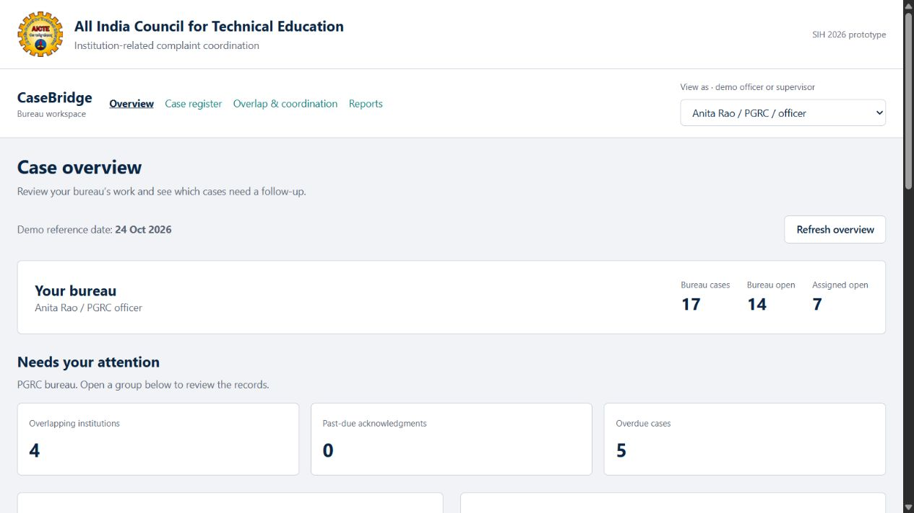

# CaseBridge

**Institution complaint monitoring and coordination across bureaus.**

CaseBridge brings institution-related complaints into a shared workspace so bureau officers can identify related cases, coordinate document requests, and follow up with clear ownership. Built as a Smart India Hackathon 2026 prototype, it keeps each case's status and history separate while helping teams avoid repeated work.

[Live demo](https://casebridge-rho.vercel.app/) · [Try the coordination workflow](https://casebridge-rho.vercel.app/#overlaps/1/2) · [Run locally](#run-locally) · [Deployment guide](DEPLOYMENT.md)



> **Demo scope:** All records are synthetic. The officer selector demonstrates bureau roles; it is not production authentication. CaseBridge is a student prototype, not an official AICTE service.

## Why CaseBridge

When complaints concerning one institution reach different bureaus, officers need to see the related work before asking for the same documents again. CaseBridge connects those records through the institution's exact **AICTE Permanent ID**, then leaves the decision to coordinate with an officer.

Matching is deterministic and rule-based. The prototype does not use AI, fuzzy matching, or automated complaint decisions.

## Key capabilities

| Capability | What officers can do |
| --- | --- |
| Case register | Find records using eight filters and register complaints for their bureau. |
| Case workspace | Review ownership, deadlines and earlier actions; record progress, transfers and escalations. |
| Institution profiles | See cases and bureau activity against one registered AICTE Permanent ID. |
| Cross-bureau comparison | Compare related cases side by side and manually confirm or reject a link. |
| Repeated-request safeguard | Check whether the same action, document category and period already have a pending request. |
| Coordination ownership | Acknowledge requests, assign an owner and follow-up date, then record completion. |
| Overview and reports | Review workload and overdue cases; download report tables and monthly or quarterly receipt-cohort figures as CSV. |

Officers can write within their own bureau. Supervisors have read-only oversight. The backend enforces these role and bureau rules and records denied write attempts in the action log.

## How coordination works

1. **Find a potential overlap.** Open cases at the same exact registered institution are surfaced across bureaus. Missing or unknown IDs remain unresolved.
2. **Review the connection.** An officer compares the records and confirms or rejects the link. Linking never merges or closes the cases.
3. **Check before requesting.** The repeated-request check uses the institution, action type, document category and period, including requests in the opposite bureau direction.
4. **Coordinate or explain.** Work with an existing request, or record a reason for proceeding separately.
5. **Assign and follow up.** The receiving bureau acknowledges the request with an owner and follow-up date. Completion becomes available after acknowledgment.

## Explore the demo

The initial dataset contains **30 cases, eight institutions and six demo users**. The demo reference date is **24 October 2026**, keeping deadlines and report periods consistent during presentations.

1. Open the [live overview](https://casebridge-rho.vercel.app/) and switch between an officer and the supervisor using **View as**.
2. Open the [Riverbend case comparison](https://casebridge-rho.vercel.app/#overlaps/1/2) to compare `PGRC-101` and `RB-201`.
3. As **Anita Rao**, choose **Document request**, enter **Fee records** and **2025-26**, then select **Check only**. A saved synthetic request demonstrates the repeated-request warning.
4. Open **Reports** to inspect bureau, institution, status, ageing and overlap figures, or download a CSV.

The public demo is shared: saved actions may change the displayed records and counts.

## Architecture

```text
React + Vite + Recharts
          |
     HTTP / JSON
          |
    FastAPI + SQLAlchemy
          |
      PostgreSQL
```

Locally, Vite proxies `/api` requests to FastAPI and Docker runs PostgreSQL. In the hosted demo, Vercel Services routes the frontend and Python API under one origin, with a dedicated Neon PostgreSQL database. Vercel Services is currently in Beta.

| Layer | Technology |
| --- | --- |
| Interface | React 19, Vite 8, Recharts, plain CSS |
| API | Python, FastAPI, SQLAlchemy, psycopg |
| Data | PostgreSQL 17 locally; managed PostgreSQL on Neon for the hosted demo |
| Verification | pytest, Node.js test runner, HTTP checks and browser walkthroughs |
| Hosting | Vercel Services and Neon |

## Run locally

The commands below use **Windows PowerShell**. Install **Python 3.12**, **Node.js 24**, **Git**, and **Docker Desktop** with Linux containers enabled. Keep ports **5432**, **8000** and **5173** available.

### 1. Clone and configure

```powershell
git clone https://github.com/AaronJJacob2007/CaseBridge.git
cd CaseBridge
Copy-Item .env.example .env
```

Edit `.env` and replace **both** `replace_with_local_password` placeholders with the same local database password. If the password contains URL-reserved characters, URL-encode it in `DATABASE_URL`. Keep `.env` private; it is excluded from Git.

### 2. Prepare the database and dependencies

```powershell
python -m venv .venv
.\.venv\Scripts\python.exe -m pip install -r backend\requirements.txt
docker compose up -d --wait
. .\scripts\load_env.ps1
.\.venv\Scripts\python.exe -m backend.bootstrap_demo
npm.cmd --prefix frontend ci
```

The bootstrap creates an empty demo database's schema when needed, applies the region migration, and loads the bundled synthetic records. Reruns preserve existing cases, requests and history; partial or unfamiliar schemas are rejected.

### 3. Start the app

In one terminal, from the repository root:

```powershell
. .\scripts\load_env.ps1
.\.venv\Scripts\python.exe -m uvicorn backend.main:app --host 127.0.0.1 --port 8000
```

In a second terminal, also from the repository root:

```powershell
npm.cmd --prefix frontend run dev
```

Open [CaseBridge](http://127.0.0.1:5173/). The API exposes [health](http://127.0.0.1:8000/health) and [interactive documentation](http://127.0.0.1:8000/docs). Press **Ctrl+C** in each terminal to stop its server; PostgreSQL remains running until `docker compose stop`.

## Verification

With the local database prepared, run the backend suite from the repository root:

```powershell
. .\scripts\load_env.ps1
.\.venv\Scripts\python.exe -m pytest backend\tests -q
```

With both development servers running, build and check the frontend:

```powershell
npm.cmd --prefix frontend run build
npm.cmd --prefix frontend test
```

**Verified on 30 October 2026:** 214 backend tests, 44 local frontend checks, and 43 applicable checks against the public deployment passed. The cloud run excluded the development-only Vite document check. A browser walkthrough also verified saving a reviewed link, creating and acknowledging a request, and persistence after refresh without changing either case's status.

The existing `scripts/verify.ps1` and `scripts/dev.ps1` helpers provide a combined Windows workflow, but currently expect the checkout at `C:\SIH26\CaseBridge`. The individual commands above work from another checkout location.

## Project structure

```text
backend/                API routes, business rules, models and regression tests
frontend/               React application, shared styles and frontend checks
scripts/                Windows setup, verification and development helpers
docs/                   Product screenshot
schema.sql              Original six-table PostgreSQL schema
seed_cases.csv          Synthetic complaint records
seed_users.csv          Synthetic demo users
vercel.json             Frontend and backend service routing
DEPLOYMENT.md           Hosting setup and deployment verification
```

## Prototype boundaries

- Demo identity uses `X-User-Id`; real sign-in and account management are not implemented.
- Exact registered IDs drive overlap detection. Institution names are not used to guess identity.
- Document references are filenames for demonstration; file upload and storage are not implemented.
- Monthly and quarterly reports show the current outcomes of cases received in that period, not historical period-end backlog or the number of disposals made during that period.
- No live AICTE data integration or real complaint data is included.

See the [deployment guide](DEPLOYMENT.md) for hosting details and deployment verification.

## Acknowledgments

The AICTE emblem is sourced from the official AICTE website. [Asset source and attribution](frontend/public/ASSET_SOURCES.md). Its use identifies the prototype's intended institutional context and does not imply endorsement.
